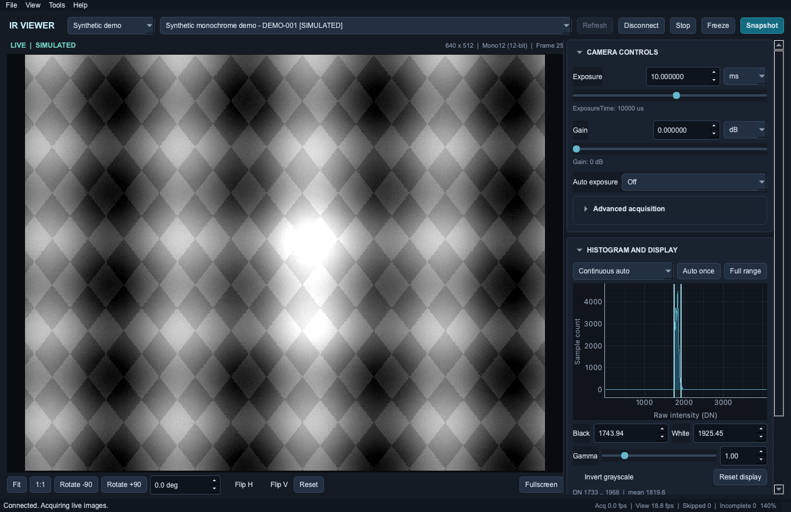

# Infrared Camera Viewer

An English-only Windows x64 desktop viewer for Allied Vision monochrome cameras through Vimba X, with interactive contrast controls and TIFF snapshots.



The screenshot shows generated demo data on macOS. It is not an image from a physical camera. Physical-camera validation is still required.

## Features

- Live grayscale preview with zoom, pan, fit, native size, and fullscreen.
- Rotation in 90-degree steps or arbitrary angles, and horizontal/vertical flips.
- Raw-DN histogram with draggable black/white levels, gamma, inversion, Auto Once, and smoothed Continuous Auto.
- Camera-discovered exposure, gain, automatic modes, frame rate, pixel format, and ROI controls where supported.
- Freeze the displayed frame while acquisition continues.
- TIFF snapshots of the displayed appearance or original grayscale data.
- Display presets, camera XML settings, diagnostics, and persistent preferences.
- An explicitly labeled synthetic demo that works without the camera SDK.

There is no video recording, drawing, annotation, measurement, or image editor.

## Run on Windows

Install **Vimba X 2026-3** and the appropriate camera drivers for real hardware. Use **Python 3.12 x64** for source installation; the supplied VmbPy supports Python 3.10 through 3.14.

1. Download or clone this repository.
2. Run `Setup-Windows.cmd`. For a custom SDK location, run `Setup-Windows.cmd "C:\path\to\Vimba X"` in a terminal.
3. Open `Launch-Windows.cmd`, select the camera, and click **Connect**. Use `Demo-Windows.cmd` to try generated images.

The [Windows viewer workflow](https://github.com/yuansui1023/infrared-camera-viewer/actions/workflows/windows.yml) builds a Windows x64 ZIP after successful checks. Download the artifact from a successful run, extract the complete application directory, and open `InfraredCameraViewer.exe`. The bundle does not require a separate Python installation; camera drivers and transport layers are still required.

See [Windows setup and troubleshooting](docs/windows-setup.md) for details.

## Common operations

| Task | Control |
| --- | --- |
| Improve contrast | Auto Once, or drag histogram black/white handles |
| Follow a changing scene | Continuous Auto, with smoothing in Automatic contrast options |
| Change exposure | Camera Controls; disable automatic exposure for manual control |
| Change format or ROI | Advanced acquisition; acquisition restarts when required |
| Inspect a stable frame | Freeze; display adjustments remain available |
| Save an image | Snapshot or Ctrl+S |
| Choose TIFF type and folder | Snapshot Settings |
| Fullscreen | F11; Escape exits fullscreen |

## TIFF behavior

Each click saves the exact frame currently displayed, including a frozen frame. Zoom and pan do not crop the saved image.

- **Display appearance:** full-resolution 8-bit grayscale with current levels, gamma, inversion, rotation, and flips. Arbitrary rotation expands the canvas.
- **Original grayscale:** unchanged pixel values and orientation in uint8 or uint16 storage, with the effective source bit depth recorded in metadata. A 12-bit source remains 12-bit data in a 16-bit container; it is not scaled to fill 16 bits.

Packed monochrome formats are unpacked through the SDK before processing. TIFF metadata records frame identity, timing, display settings, and available acquisition information. Cached camera readbacks are distinguished from per-frame chunk data.

## Development

```powershell
python -m venv .venv
.venv\Scripts\python -m pip install ".[camera,build]"
.venv\Scripts\python -m unittest discover -s tests -v
.venv\Scripts\python -m ir_camera_viewer --demo
./Build-Windows.ps1 -Python .venv\Scripts\python.exe
```

Synthetic development on macOS or Linux uses `pip install -e .` and does not load Windows SDK libraries. The real camera backend requires Windows and VmbPy 1.2.3.

The local suite passes 40 numerical, SDK-contract, TIFF, and offscreen UI tests. Windows packaging checks run separately in CI. Neither synthetic data nor a mocked SDK proves compatibility with the physical camera. See [validation](docs/validation.md).

## Project documents

- [Development specification](docs/development-prompt.md)
- [Inspected SDK assessment](docs/sdk-assessment.md)
- [Architecture and frame ownership](docs/architecture.md)
- [Contributor instructions](AGENTS.md)

Vendor SDK files, drivers, wheels, credentials, local settings, and camera captures are excluded from version control. The exact physical camera model and interface remain unconfirmed; simulator presets do not establish those facts.
